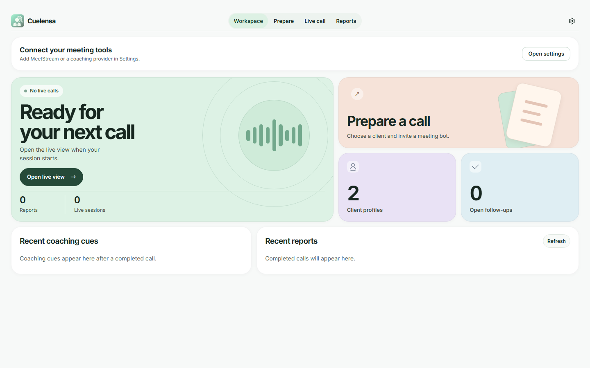

#  Cuelensa

**A self-hosted workspace for client calls, live coaching, and follow-through.**

[](https://github.com/ThalhaAhamed/clientluma/actions/workflows/ci.yml) [](LICENSE)

[Quick start](#quick-start) · [Features](#features) · [Screenshots](#screenshots) · [Architecture](#architecture) · [Configuration](#configuration) · [Documentation](#documentation)

## Quick start

Install Node.js 22.13 or newer, then run these commands from the project directory.

```sh
npm ci
npm start
```

Open [localhost:4000](http://localhost:4000). In **Prepare**, create a client, optionally add their public website, and generate a brief. Local analysis works without an AI key.

To capture a call, configure a MeetStream API key and an [HTTPS callback route](docs/integrations.md#meetstream). Choose **Meeting bot**, paste your meeting link, and admit the bot if your host settings require it. In **Live call**, enable **Client Lens** to receive coaching and open the compact cue overlay. Choose **End call & build report** when you’re done.

### Installation options

| Option | Start here |
| --- | --- |
| Source on your computer | `npm ci` and `npm start`. [Local setup](docs/self-hosting.md#source-installation) |
| Docker on your computer | `docker compose up --build -d` with Docker Compose 2.24 or newer. [Docker setup](docs/self-hosting.md#docker) |
| Server with HTTPS | Deploy the app behind Caddy with a hostname and password sign-in. [Hosted setup](docs/hosting.md) |

## Features

| Workflow | What Cuelensa does |
| --- | --- |
| Prepare | Build a client brief from profile notes and public website research. Review crawl progress, refresh or remove the index, and open the source beside each researched discovery question. |
| Meeting bot | Capture a live transcript from MeetStream. Optionally enable Client Lens for coaching cues and compact **View source** links. |
| Meeting assistant | Use a wake phrase, usually **Hey MIA**, to ask about the selected client, search connected product docs, or log a follow-up. |
| Client Lens only | Use local English recognition on shared tab audio in a supported desktop browser. This mode produces live cues without saving a transcript or report. |
| Reports | Review transcript-backed observations, evidence, and proposed next steps. Track follow-ups and export Markdown. |

Cuelensa connects to a trusted, read-only product documentation MCP tool. In Prepare, you can also approve client-specific documents as sources for live coaching. [Integrations](docs/integrations.md)

## Screenshots



[View the Prepare screen with a fictional client](docs/screenshots/prepare.png)

## Architecture

Cuelensa serves a browser workspace and a compact cue overlay from one Node.js process. MeetStream calls the server’s token-protected endpoints. WebSockets deliver live transcript and coaching updates to the browser. SQLite is the default store, with PostgreSQL available for deployments that need it. [Architecture and data flow](docs/architecture.md)

### Project structure

| Path | Purpose |
| --- | --- |
| [server.js](server.js) | HTTP API, callback authentication, and WebSocket entry point |
| [lib/](lib/) | Meeting sessions, providers, coaching, website indexing, and storage |
| [public/](public/) | Browser workspace, local Client Lens, and compact overlay |
| [scripts/](scripts/) | Local HTTPS tunnel and hosted smoke test |
| [test/](test/) | Unit, integration, PostgreSQL, and browser tests |
| [.github/](.github/) | CI, dependency updates, and issue and PR templates |

## Configuration

Use **Settings** for workspace connections and `.env` for deployment settings. Environment values take precedence. See [`.env.example`](.env.example) and the [configuration reference](docs/configuration.md) for defaults and restart requirements.

| Setting | Purpose |
| --- | --- |
| `MEETSTREAM_API_KEY` | Send and manage meeting bots |
| `PUBLIC_URL` | Set the HTTPS origin used by MeetStream callbacks |
| `MIA_PROVIDER` | Select local rules, Gemini, or Claude for prep, coaching, and reports |
| `MIA_DOCS_MCP_URL` | Connect product documentation search |
| `MIA_DATABASE_PROVIDER` | Select SQLite or PostgreSQL |

See [Privacy and data handling](docs/privacy.md) for what each mode stores and sends to providers.

## Tests and CI

```sh
npm ci
npm test
npx playwright install chromium
npm run test:e2e
```

GitHub Actions runs the test suite on Linux and Windows, verifies PostgreSQL and hosted HTTPS, and scans dependencies, the container image, and Git history. Live Google Meet audio and transcription require a separate test with a real meeting and MeetStream account. [Development checks](docs/development.md)

## Troubleshooting

| Symptom | First check |
| --- | --- |
| Bot waits in the lobby | Admit the bot in your meeting or check the host’s guest access settings. |
| Bot joins but the transcript is empty | Confirm someone is audible in the meeting. Check MeetStream’s audio status and transcript job, then verify the callback origin. |
| Client Lens only does not generate a report | This mode produces live cues. Use **Meeting bot** for an authorized call you intend to save and review. |

[Full troubleshooting guide](docs/troubleshooting.md)

## Documentation

- [Setup](docs/self-hosting.md) · [HTTPS hosting](docs/hosting.md) · [Configuration](docs/configuration.md) · [Integrations](docs/integrations.md)
- [Architecture](docs/architecture.md) · [Privacy](docs/privacy.md) · [Troubleshooting](docs/troubleshooting.md)
- [Development](docs/development.md) · [Contributing](CONTRIBUTING.md) · [Agent guide](AGENTS.md) · [Changelog](CHANGELOG.md) · [Security policy](SECURITY.md)

## Contributing and license

Use fictional data when testing or reporting a problem. See [Contributing](CONTRIBUTING.md) to get started. Cuelensa is released under the [MIT license](LICENSE). The GitHub repository retains its original `clientluma` name.
