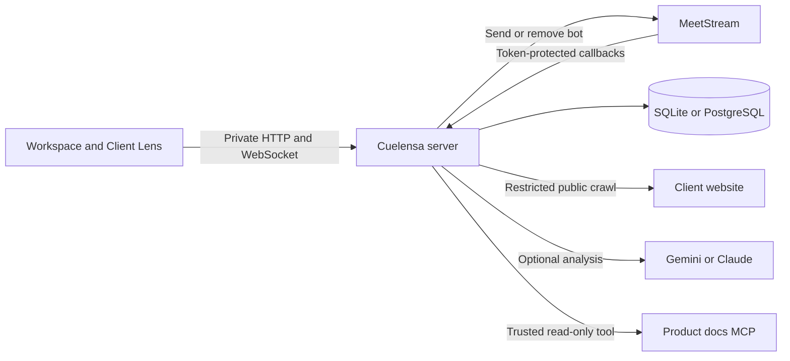

# Architecture

MeetStream sends transcript and status events to authenticated callbacks. The workspace streams live session updates to the browser and Client Lens over WebSockets. Client profiles, approved documents, reports, and follow-ups are stored in the configured SQLite or PostgreSQL database.

- The **meeting bot** captures speech without participating in the conversation.
- The **meeting assistant** answers when called by its wake phrase. Its authenticated tools use the client bound to the assistant's bot ID. A separate silent bot can capture the transcript when the assistant cannot stream it directly.
- **Client Lens** controls live analysis and cues per meeting. Turning it off pauses live analysis while capture continues. Ending the call builds the report from the transcript.
- With Gemini or Claude enabled, the selected provider receives the client context and transcript needed for analysis. MeetStream processes meeting media when a bot joins.
- **Client Lens only** processes shared-tab audio with on-device browser recognition. It creates no server session, saved transcript, or report.
- Website Intelligence stores bounded, sourced excerpts per client. The crawler checks robots rules, validates and pins public DNS addresses, and treats page content as untrusted. Approved technical documents are the separate source of product claims during coaching.

Live sessions and WebSocket connections belong to one server process. End active calls before updating or backing up the workspace. The application stores completed reports with the client and serializes writes to each client within that process.

See the [self-hosting guide](self-hosting.md) for the workspace and callback boundaries.
